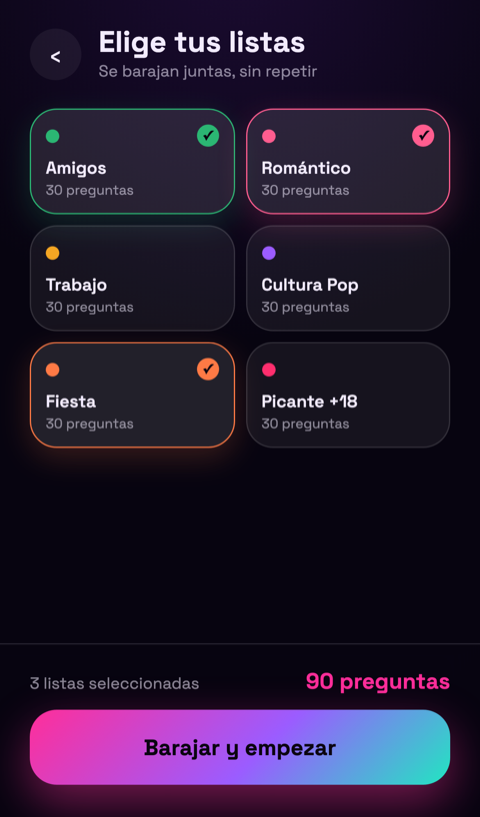
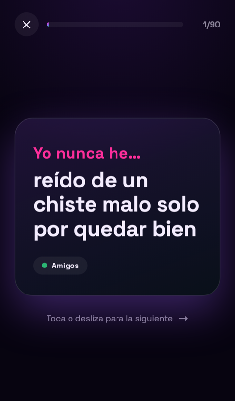
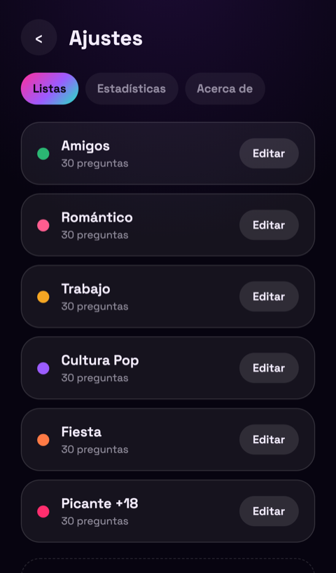
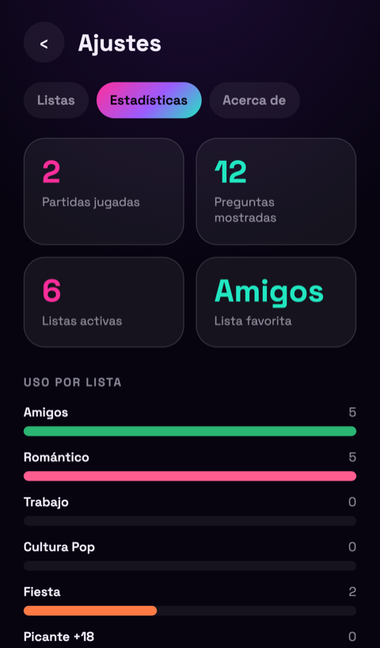
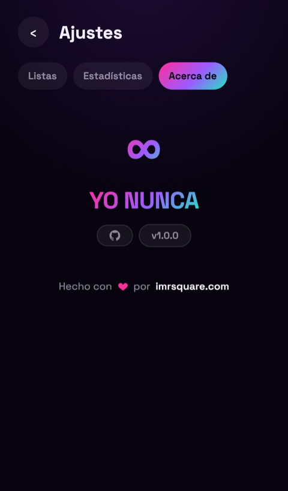

<p align="center">
  
</p>

<h1 align="center">Yo Nunca</h1>

<p align="center">
  Juego web del clásico "Yo nunca he...". Elige listas de preguntas, mézclalas al azar y jugad pasando el móvil.
</p>

---

## 1. Instalación con Docker Compose

Requisitos: [Docker](https://docs.docker.com/get-docker/) y [Docker Compose](https://docs.docker.com/compose/).

Crea un `docker-compose.yml`:

```yaml
services:
  yo-nunca:
    image: ghcr.io/imrsquare/yo-nunca:latest
    container_name: yo-nunca
    restart: unless-stopped
    environment:
      ADMIN_PASSWORD: ${ADMIN_PASSWORD}
    ports:
      - "3015:3000"
    volumes:
      - ./data:/app/server/data
```

Y levántalo:

```bash
docker compose up -d
```

## 2. Contraseña de administración por defecto

Si no defines `ADMIN_PASSWORD`, se usa la contraseña por defecto:

```
cambiame123
```

Cámbiala antes de exponer la app fuera de tu red local (ver variables de entorno abajo).

## 3. Variables de entorno

| Variable | Obligatoria | Por defecto | Descripción |
|---|---|---|---|
| `ADMIN_PASSWORD` | No | `cambiame123` | Contraseña de acceso al panel de administración (`/adm`). Se lee en tiempo de ejecución: para cambiarla basta con editarla y hacer `docker compose up -d`, sin reconstruir la imagen. |

## 4. Primer acceso

- **Jugar**: abre `http://localhost:3015`.
- **Administrar listas**: abre `http://localhost:3015/adm` e introduce tu `ADMIN_PASSWORD`. Desde ahí puedes crear listas propias, protegerlas con contraseña individual y consultar estadísticas de partidas.

Las listas y estadísticas se guardan en `./data` (base de datos SQLite), que persiste entre reinicios del contenedor.

## 5. Capturas

| Inicio | Elegir listas | Partida |
|---|---|---|
|  |  |  |

| Listas (admin) | Estadísticas (admin) | Acerca de (admin) |
|---|---|---|
|  |  |  |
